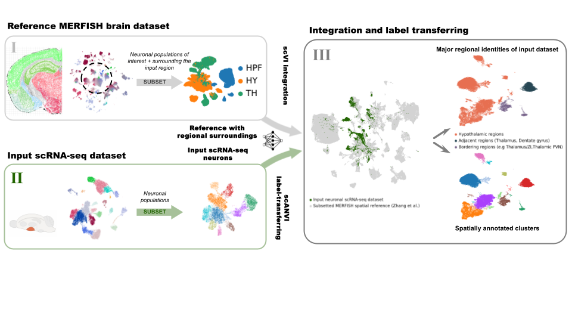
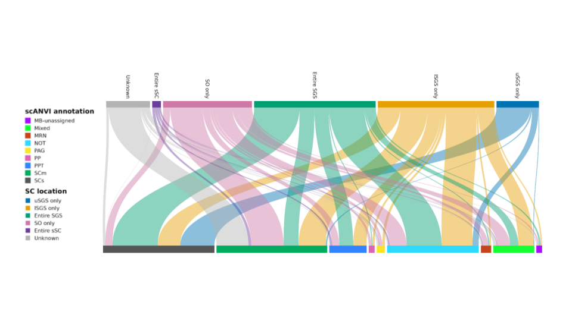

# Spatial Classifier

Single-cell and single-nucleus RNA sequencing enable detailed analysis of cellular diversity and experimental changes in cell composition and gene expression, but tissue dissociation removes anatomical context. Whole-brain spatial transcriptomic atlases offer an opportunity to recover regional information from independently collected sequencing datasets. Here, we present a workflow for anatomical annotation of neuronal transcriptomes using a mouse MERFISH reference and evaluate it in hypothalamic, midbrain and thalamic datasets. The workflow combines scVI integration with scANVI label transfer to assign regional and subregional identities. Inclusion of surrounding structures enables identification of likely off-target populations originating from adjacent regions while retaining anatomically mixed categories.



<!--
Author checklist:
- Replace the classifier name, descriptions, commands, flags, paths, and tables.
- Document actual input requirements and output filenames.
- Delete optional subsections that do not apply to the implementation.
- Replace the two PNGs in assets/images/ while keeping their filenames,
  or update the image links below if you rename them.
- Remove this checklist and the visible Blueprint note when ready to publish.
-->

- [Basic usage](#basic-usage)
- [Advanced usage](#advanced-usage)

## Basic usage

Basic full workflow consists of downloading reference files, subsetting them to the region of interest with surrounding structures and runnin integration with label transfering on input + reference datasets. If reference was already downloaded or/and subsetted, shorter subroutines can be ran

### 1. Installation

Installtaion requires clonning of the repository and installation of projection environment

```bash
git clone https://github.com/BMG-IDB-Lab/spatial-classifier
cd spatial-classifier
conda create -f environments/projection_environment.yml
```

### 2. Prepare the inputs

Input preparation can be done separately or through the launch of full workflow or through running specific scripts for each of those steps.

If you decide to run those scripts separately, do the following:

```bash
python3 src/downloader.py -o OUTPUT_DIR
python3 src/reference_subsetting.py --region REGION_OF_INTEREST -i REFERENCE_DIR -o --OUTPUT_DIR
```

### 3. Run the classifier
There are two basic ways to run the classifier:
1. As a full workflow:

```bash
python3 src/conductor.py \
  --reference_dir  REFERENCE_DIR\ #where to upload references
  --input_dir INPUT_FILE_DIR
  --base True
```

2. As subprocess without downloading and reference subsetting steps:

```bash
python3 src/conductor.py \
  --sub True \
  --reference_dir  REFERENCE_DIR\ #where already uploaded references are already located
  --input_dir INPUT_FILE_DIR
  --base True
```

### 4. Inspect the results

Basic run will produce spatially annotated dataset, prediction table for cells as metadata and summary with integration metrics.

| Output | Contents |
| --- | --- |
| `spatially_annotated.h5ad` | Spatially annotated adata object with two new columns 'Spatial_clust', 'Spatial_region', conataining two levels of spatial annotatio. |
| `cells_annotated.csv` | Metadata from adata object  |
| `summary.csv` | scIB metrics for integration and summary for cell projection |


## Advanced usage

Advanced workflow contains additional options with plotting module for results and probabiity outputs for cell projections 

### 1. Plotting module

As with basic workflow, plotting module can be called as a flag in full pipeline or as a separate script for plotting:

1. As a full workflow:

```bash
python3 src/conductor.py \
  --sub False \
  --reference_dir  REFERENCE_DIR\ #where to upload references
  --input_dir INPUT_FILE_DIR
  --base False #running it without --base flag at all or setting it to False    
```

2. As subprocess without downloading and reference subsetting steps:

```bash
python3 src/plotter.py \
  --input INPUT_DIR \ # already spatially annotated input file
  --fig_dir OUTPUT_FIGURE_DIR
```
Additional images will contain visualizations, such as UMAP with input projected on reference, UMAP with spatially annotated input dataset and sankey plot for distribution of annotated cells:



### 2. Probabiity outputs

To get additional table with assigned probability of annotation through all of available classes for each cell you only need to add --prob True flag to any of the launches of the conductor.py. As results, table with probablility distribution of annotation for each cell will be added to output directory.


